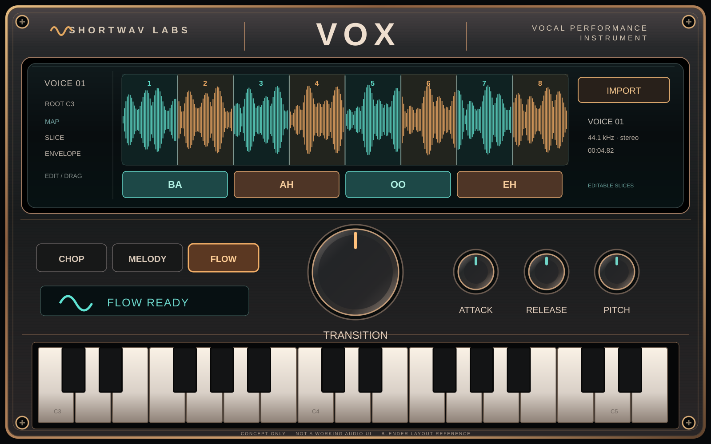

# VOX — A playable vocal performance experiment

**Shortwav Labs · Plugin Jam 2026–27 · Design / feasibility stage**

> **Concept:** Turn a short vocal phrase into a playable, expressive instrument. **VOX is a working codename, not a trademark-cleared product name.** No plugin, DSP implementation, or host validation exists in this repository yet.

## The idea

Drop in a dry vocal phrase. VOX proposes editable fragments, maps them to playable MIDI triggers, and explores transitions that connect those fragments into a phrase rather than only restarting isolated samples. The central research question is **whether a FLOW performance mode produces a musically compelling result compared with ordinary sample slicing**.

**CHOP** triggers slices as individual one-shots or gated phrases. **MELODY** maps one selected fragment chromatically using plain resampling as the early baseline. **FLOW** is the experimental differentiator: playable, explicit articulation and short crossfaded transitions between adjacent vocal fragments. “Syllables” in the UI are user-editable labels, **not promises of accurate phoneme transcription**.

VOX is *not* a Kontakt replacement, an AI singer, a speech synthesizer, a stem separator, a comprehensive sampler, or a copy of Serato Sample.

## Status

- [x] Research and competitor constraints documented
- [x] PRD, RFC, proposed DSP architecture, and visual system drafted
- [x] Front-panel SVG concept suitable as a Blender layout reference
- [ ] 48-hour offline feasibility spike and controlled listening
- [ ] Owner selects VOX vs [AFTERIMAGE](https://github.com/shortwavlabs/after-image)
- [ ] Real-time JUCE plugin, editor and host qualification — **not authorized by this design PR**
- [ ] Release and contest submission

**Do not treat this README as evidence the plugin works.**

## Documentation

| Document | Purpose |
| --- | --- |
| [Product requirements](docs/PRD.md) | Audience, problem, distinctive value, scope, user stories, success and stop gates |
| [RFC-001: Vocal performance](docs/RFC-001-vocal-performance.md) | Competing approaches, falsifiable hypotheses, controlled prototype and listening plan |
| [DSP architecture](docs/DSP-ARCHITECTURE.md) | Native instrument design, slice/playback/transition contracts, RT safety and host persistence |
| [UI and Blender design](docs/UI-CONCEPT.md) | Product interaction, front-panel layout, render layers, accessibility, SVG reference |
| [Research](docs/MARKET-RESEARCH.md) | Official competitor functionality, differentiation limits, external URLs and Jam constraints |
| [Licensing](docs/LICENSING.md) | AGPL choice, dependency and audio-asset rights, submission obligations |
| [Prototype plan](docs/PROTOTYPE-PLAN.md) | Two-day strict decision gate and AFTERIMAGE comparison |
| [Front-panel concept](docs/ui/vox-front-panel.svg) | Editable, illustrative vector UI reference; not a screenshot of working software |

## Proposed target (conditional on feasibility approval)

- **JUCE 9 / C++20 / CMake**, macOS AU + VST3, Windows VST3 after actual platform qualification.
- MIDI-controlled **instrument**, not a MIDI effect or audio-insert processor.
- One user-supplied audio recording per patch in MVP, editable slices, click-free overlapping voices, sample rate conversions, deterministic playback, optional FLOW.
- User audio **stays local**; imported samples are not tracked in this repository, nor redistributed with demo assets unless licensed.

## Plugin Jam constraints

The official [Plugin Jam rules](https://www.theaudioprogrammer.com/events/plugin-jam-rules) list submission by **31 January 2027 at 11:59 PM Pacific**, with a free working signed (and notarized if Mac) VST3/AU/CLAP for Mac and/or Windows, a public source repository, an OSI-approved license, and a demo video of at most three minutes. **The Jam permits one entry per person/team**; VOX and AFTERIMAGE are candidates, not two committed submissions. Always re-check current rules before submitting.

## Licensing

Original work: **AGPL-3.0-only** (see [LICENSE](LICENSE)). Intended JUCE open-source route: AGPLv3, with exact pinned version and dependency obligations to be verified before any framework code is introduced. VOX does not claim rights to third-party vocal recordings, product names or trademarks. See [docs/LICENSING.md](docs/LICENSING.md).

## Origin

Created for Shortwav Labs as a time-boxed challenger to AFTERIMAGE. POCKET (drum/bass performance humanizer) remains a separate, deferred commercial idea and is not in this repository's implementation scope.
